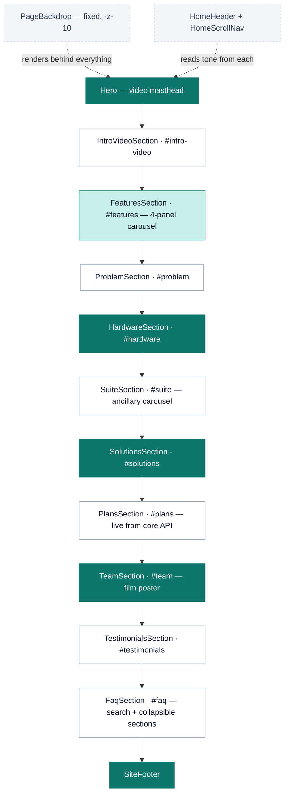
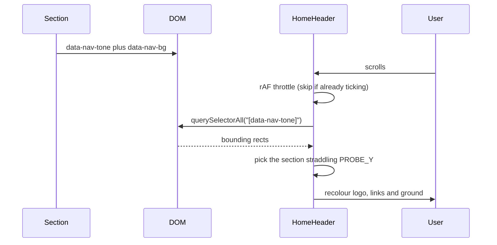
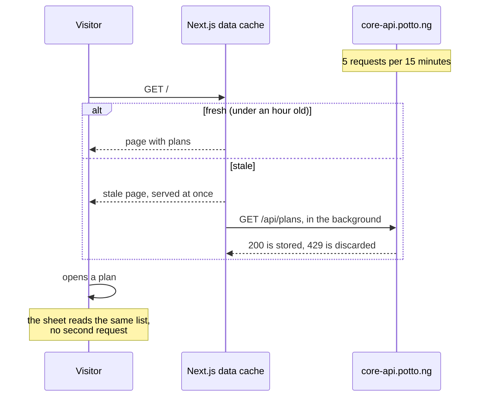
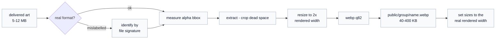

# Potto — marketing site

The public site for [potto.ng](https://potto.ng), a Nigerian school-security
platform: one long homepage, plus `/privacy` and `/terms`.

> **Read [`AGENTS.md`](AGENTS.md) before writing code.** This is Next.js **16**,
> whose APIs and conventions differ from older versions. The guides in
> `node_modules/next/dist/docs/` are the authority, not memory or older tutorials.
>
> That file also carries the short list of **project rules** — the things that
> break when they are ignored. This README is the reasoning behind them.

---

## Stack

| Concern | Choice | Notes |
| --- | --- | --- |
| Framework | Next.js 16.3.1, App Router | Turbopack; the homepage prerenders static and regenerates hourly for live plan data |
| UI | React 19.2 | the routes are Server Components; the homepage's sections are client components (`"use client"`) |
| Styling | Tailwind CSS v4 | CSS-first config in [`globals.css`](src/app/globals.css) — there is **no** `tailwind.config.js` |
| Animation | framer-motion 13 | scroll reveals, carousels, modals |
| Icons | `@hugeicons/react` + `@hugeicons/core-free-icons` | the house icon set |
| Fonts | Poppins (400/600/700), Geist Mono | via `next/font/google` |

Every remaining dependency is used. `shadcn` and `tw-animate-css` are pulled in
by `globals.css` for their **token vocabulary and utilities only** — no shadcn
component is rendered anywhere, and `src/components/ui/` does not exist. `gsap`
drives the hero marquee and entrance; everything else animates with
framer-motion.

## Quick start

Requires **Node ≥ 20.9**.

```bash
npm install
npm run dev      # http://localhost:3000
npm run build    # production build — run this before every commit
npm run lint     # eslint
npx tsc --noEmit # typecheck (not wired into a script)
```

---

## Routes

| Route | What it is |
| --- | --- |
| `/` | The homepage. Static, regenerated hourly for live plan data |
| `/privacy` | Privacy Policy — an **unreviewed draft**, see Known gaps |
| `/terms` | Terms and Conditions — an **unreviewed draft**, see Known gaps |

The legal pages share [`LegalPage`](src/components/LegalPage.tsx), which renders
the header and footer itself. That is why the header and footer links are
root-relative (`/#features`): a bare `#features` goes nowhere from `/privacy`.

---

## Page composition

Sections are composed in [`src/app/page.tsx`](src/app/page.tsx) in this order.
Every section declares a **tone** that drives the header colour (see below).



Teal = dark ground. `FeaturesSection` switches tone panel by panel.

### The "one picture" rule

[`PageBackdrop`](src/components/PageBackdrop.tsx) paints a single fixed canvas
plus a generated contour pattern for the **whole page**. Sections render
transparent on top of it, or paint their own ground when they need one (the teal
bands). The site is meant to read as one continuous image from header to footer —
**avoid boxes, frames and cards floating on visible panels.**

---

## How the header knows what colour to be

There is no scroll-position table. Each section advertises its own tone, and the
header samples whichever section is under a fixed probe line.



**Any new section must declare both attributes**, or the header falls back to the
light default and its links vanish over a dark ground.

```tsx
<section
  id="my-section"
  data-nav-tone="dark"
  data-nav-bg="var(--color-brand-teal-dark)"
  className="relative bg-brand-teal-dark py-24 text-white md:py-32"
>
```

A section only needs an `id` if it is a scroll-nav target. `FeaturesSection`
dispatches a synthetic `scroll` event when its panel changes, so the header
re-probes without the user moving.

---

## Plans data

The plans come live from `https://core-api.potto.ng/api/plans`, fetched **on the
server** in [`get-plans.ts`](src/lib/get-plans.ts) and cached for an hour. That
is not an optimisation, it is a requirement: the API allows **5 requests per 15
minutes** (`ratelimit-policy: 5;w=900`).



- **Never fetch plans from the browser.** A visitor clicking through plans would
  be locked out after five clicks.
- **The detail endpoint is not used.** `/api/plans/detail/:id` returns exactly
  the plan's entry in the list, so the sheet reads what the page already has.
- **Next stores only 200 responses**, so a throttled background refresh keeps
  the last good plans. `getPlans()` returns `null` only on a cold cache, and the
  section then shows a fallback link to the app.
- **In development a hard refresh bypasses the cache** (`cache-control: no-cache`).
  Five of those in 15 minutes and you will see the fallback — that is the rate
  limit, not a bug.
- **`altUrl` on an app means "not in this plan".** Empty = included; otherwise
  it links to the plan that includes it, which the sheet turns into an
  "Available on …" switch.
- **The ancillary services read the same list.** Each is matched to an API
  app by name (ignoring "Potto" and spacing) for its real product icon
  (`findApp`) and the plans that include it (`plansIncluding`), both in
  `lib/plans.ts`. `page.tsx` passes the one fetched list to both sections, so
  this costs no extra request.

[`lib/plans.ts`](src/lib/plans.ts) holds the types, the parser (the response is
validated, not trusted) and the display helpers, and is safe to import from
client components. Plan and app icons are Cloudinary URLs served through
[`cloudinaryLoader`](src/lib/cloudinary.ts), **not** Next's image optimizer. The
optimizer gives each upstream fetch a hard-coded 7 seconds; opening a plan
requests about nine icons at once over a slow link, and on a cold cache they
timed out and rendered as broken images. Cloudinary resizes them on its own
CDN instead, which is also why there is no `remotePatterns` config.

---

## Design system

Tokens live in [`globals.css`](src/app/globals.css) under `@theme` (fixed brand
palette) and `@theme inline` (semantic aliases). **Light theme only** —
`color-scheme: light` is declared and there is no dark mode.

| Token | Value | Use |
| --- | --- | --- |
| `--brand` | `#0F766E` | primary teal; AA with white text |
| `--color-brand-teal` | `#0D9488` | hover teal |
| `--color-brand-teal-dark` | `#0F766E` | dark section grounds |
| `--color-brand-gold` | `#CA8A04` | CTA fills — **fills only, see below** |
| `--color-brand-yellow-light` | `#FACC15` | accent text on teal |
| `--ink` / `--soft` | `#000000` / `#6B7280` | body text on light |
| `--highlight` | `#FACC15` | marker-pen underline behind accent words |
| `--canvas` / `--surface-2` | white / near-white | page and inset fills |

### Contrast, measured

Gold is a **fill colour, not a text colour on teal**. Real ratios against the
`#0F766E` ground:

| Foreground on teal | Ratio | Verdict |
| --- | --- | --- |
| `brand-gold` `#CA8A04` | **1.86** | unusable |
| `brand-yellow` `#EAB308` | 2.85 | fills only |
| `brand-yellow-light` `#FACC15` | 3.57 | short accents only |
| `text-white/75` | 3.82 | too low for body |
| `text-white/90` | **4.76** | body copy on teal |

For reference, light-theme body text (`#6B7280` on white) is **4.83**, so
`text-white/90` is the teal equivalent. Filled gold tiles are fine — a shape
carries a colour that 14px type cannot.

### Animation

Three custom keyframes are defined inside `@theme`, each reading its colour from
a per-element `--glow` custom property so one animation serves every accent:

- `animate-glow` — breathing box-shadow on CTAs
- `animate-halo` — slow halo behind play buttons
- `animate-pulse-ring` — expanding ring; two, offset in time, read as continuous

Usage: `className="animate-glow [--glow:var(--color-brand-teal)]"`.
A `prefers-reduced-motion` block disables all three.

---

## Shared components

| Component | Role |
| --- | --- |
| [`SectionCaption`](src/components/SectionCaption.tsx) | The centred uppercase eyebrow **every** section opens with. Tone-aware. Use it — do not hand-roll another. |
| [`Modal`](src/components/Modal.tsx) | Portalled dialog: backdrop, Escape, scroll lock with scrollbar compensation. `placement="bottom"` makes it a sheet that slides up and drags down by its handle. Modals stack correctly — Escape closes only the top one. Deliberately **does not scroll** — content that can outgrow the space scrolls itself, because a scroll container here clipped the card and its CTA. |
| [`PlanDrawer`](src/components/PlanDrawer.tsx) | The plan-details sheet: price, description, customization and managed-service flags, featured apps (locked ones offer a switch to the plan that has them) and the other plans. |
| [`VideoLightbox`](src/components/VideoLightbox.tsx) | `Modal` plus a `<video>` keyed on `src`, so switching clips remounts the element. |
| [`PlayBadge`](src/components/PlayBadge.tsx) | The glowing play control laid over video posters (Problem, Team). Decorative; the button around the poster takes the click. |
| [`PageBackdrop`](src/components/PageBackdrop.tsx) / [`ContourPattern`](src/components/ContourPattern.tsx) | The single page-wide ground; contour lines are generated in JS, not an asset. |
| [`HomeHeader`](src/components/HomeHeader.tsx) | Tone-adaptive header — see the probe mechanism above. |
| [`HomeScrollNav`](src/components/HomeScrollNav.tsx) | Vertical dot rail, desktop only (`lg:block`), driven by a hand-maintained `SECTIONS` list. |
| [`LegalPage`](src/components/LegalPage.tsx) | Shell for `/privacy` and `/terms`: kicker, title, revision date, contents links, numbered sections. A `confirm` block renders a deliberately loud `To confirm:` gap. |
| [`WhatsAppButton`](src/components/WhatsAppButton.tsx) | Fixed customer-care link, bottom-right, mounted in `layout.tsx` so every route has it. A Server Component — it ships no JavaScript. `z-40` keeps it under the dialogs. |

### Patterns worth copying

- **Scroll reveal.** Every section defines a local `reveal(delay)` returning
  `initial` / `animate` / `transition`, gated on
  `useInView(ref, { once: true })`, with a shared `ease = [0.22, 1, 0.36, 1]`.
- **Carousels are scroll-snap tracks**, not JS transforms — native swipe,
  trackpad and keyboard scrolling come free, and the arrows are just `scrollTo`.
  Page state is *derived from* scroll position, never the driver.
- **Carousel controls belong beside the heading**, not under the track. Below it
  they are a card-height down the page, and nobody scrolls to discover that
  scrolling is possible.
- **No `setState` inside an effect body.** The `react-hooks/set-state-in-effect`
  rule is enforced as an **error**. For a hydration-time value use
  `useSyncExternalStore` with a never-notifying subscribe (see `Modal`,
  `SiteFooter`); for measurement, let `ResizeObserver` fire on `observe`.

---

## Assets

`public/` holds **24 files, 19 MB — every one referenced by exact path.** It was
98 MB before a sweep of unreferenced sources; keep it that way, because nothing
prunes it automatically and everything in it ships.

Source art arrives large (5–12 MB PNG/JPG, occasionally with the wrong
extension). Everything on the page is a cropped, resized WebP:



Rules that came out of doing this the hard way:

- **Keep originals out of `public/`.** A `.png` master beside its `.webp` ships
  to every visitor. Masters belong outside the repo, not next to the derivative.
- **Check the file signature, not the extension.** One delivered file was a
  5.7 MB PNG named `.webp`; browsers sniff the bytes, so it renders fine and the
  mistake survives.
- **Crop to the alpha bounding box.** Delivered art is often parked off-centre in
  a larger canvas; `object-contain` centres the *canvas*, so the subject renders
  small and visibly shifted. `trim()` will not help when the margin is
  transparent rather than a solid colour — measure the bbox and `extract`.
- **Match the box to the art's aspect ratio.** A square image in a wide, short
  box fits by height and wastes the width.
- **`sizes` must match the real rendered width.** Overstating it makes Next fetch
  twice the pixels. Compute the grid track width; do not guess with `30vw`.
- **Flatten anything that must be opaque** — a stray alpha channel lets the
  section ground punch through a photo.

---


## Known gaps

Tracked here rather than in code comments so they stay visible.

| Gap | Detail |
| --- | --- |
| Dead links | `/register` (the header's "Get started", on desktop and in the mobile menu, and once in the footer) and `/services/potto-*` (6 Learn More links) — those routes do not exist, and `/register` logs a 404 in the console on every page load because production `<Link>`s prefetch. Plan sign-ups already go to the real app at `core.potto.ng/app/plan-detail/{id}` |
| Legal pages | `/privacy` and `/terms` exist and are linked from the footer. The text is a **draft no lawyer has reviewed**; the "draft for review" banner is written but commented out in [`LegalPage.tsx`](src/components/LegalPage.tsx) |
| Legal facts still unknown | The on-page `To confirm:` markers have been removed from Privacy, so the open questions are recorded here instead. **Privacy:** the registered entity name and RC number; how parental consent is evidenced; what the devices store for face recognition (template or image, on the device or on the server) and for how long; the named sub-processors and hosting region; retention periods per record type; whether records are encrypted at rest; the DPO's name; and whether any aggregated school data is used for analytics. **Terms:** the billing period behind each published plan price, payment and refund terms, device ownership and warranty, Free-plan limits, any uptime commitment, notice periods, the liability cap, and the dispute forum. Every one of these is a commercial or engineering decision, not a drafting choice |
| Empty hero | `Hero.tsx`'s `<h1>` renders nothing while `MESSAGES` and the rotate interval are still live |
| Scroll-nav order | Fixed, but fragile by design: `HomeScrollNav`'s `SECTIONS` list is hand-maintained and **must stay in `page.tsx` order**. The active dot is the last entry whose top is above the probe, walked in list order, so one entry out of sequence highlights the wrong dot. It had already drifted once |
| Placeholder content | Testimonial quotes, names and `avatars/avatar1–4.jpg` are stand-ins |
| Copy needing sign-off | Ancillary service URLs are provisional |
| Plan data | Prices carry no billing period in the API (per student? per term?), so none is shown. Suite's `pageTitle` and Enterprise's `desc` are the same sentence, so their cards share a tagline |
| Plan video | The API has no video field; every plan's Play video shows `intro.mp4` |
| Potto Comm | The one ancillary service with no counterpart among the API's apps, so it is the only card with no plan availability and no product icon — it keeps a stand-in hugeicon |
| WhatsApp number | The floating chat button opens `wa.me/2349064566528` (0906 456 6528). Confirm it is the line customer care actually watches, and remember wa.me needs the international form with no leading zero |
| Team placeholders | `public/team/placeholder-team.webp` is a transparent composite of the Benefits cut-outs, so the section's teal is its background; the film is `intro.mp4`; the blurb is placeholder copy. Swap the image, then clear `.next/cache/images` — and `.next/dev/cache/images`, which `npm run dev` keeps separately |
| FAQ search | Plain substring matching, no stemming — "setup" does not find "set **up**", which is how most of the answers phrase it |
| Not built | Pricing detail, Contact, How-it-works |
