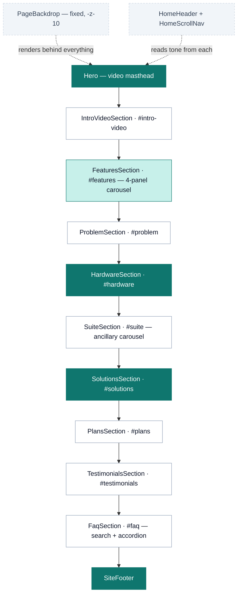
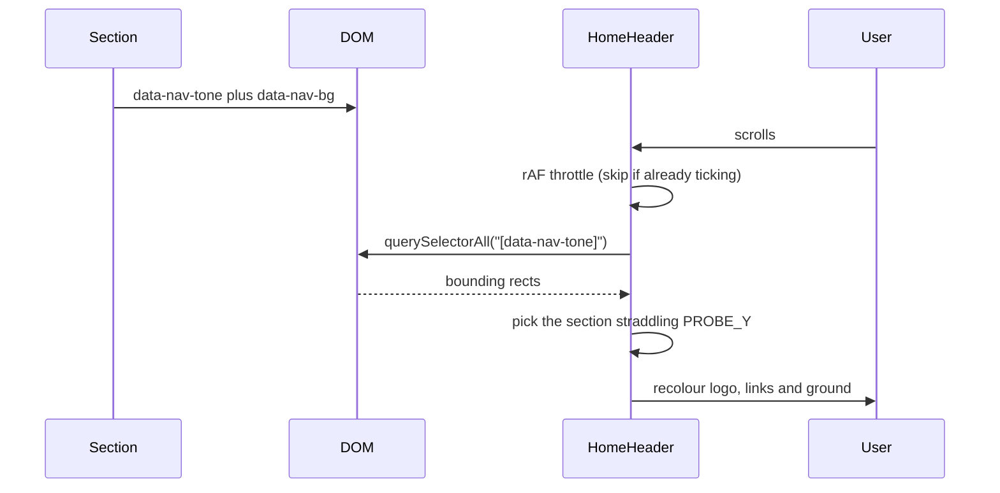
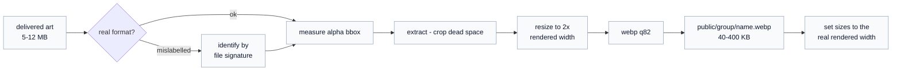

# Potto — marketing site

The public homepage for [potto.ng](https://potto.ng), a Nigerian school-security
platform. One long single-page site: hero to footer, no sub-routes yet.

> **Read [`AGENTS.md`](AGENTS.md) before writing code.** This is Next.js **16**,
> whose APIs and conventions differ from older versions. The guides in
> `node_modules/next/dist/docs/` are the authority, not memory or older tutorials.

---

## Stack

| Concern | Choice | Notes |
| --- | --- | --- |
| Framework | Next.js 16.3.1, App Router | Turbopack; the whole site prerenders static |
| UI | React 19.2 | every section is a client component (`"use client"`) |
| Styling | Tailwind CSS v4 | CSS-first config in [`globals.css`](src/app/globals.css) — there is **no** `tailwind.config.js` |
| Animation | framer-motion 13 | scroll reveals, carousels, modals |
| Icons | `@hugeicons/react` + `@hugeicons/core-free-icons` | the house icon set |
| Fonts | Poppins (400/600/700), Geist Mono | via `next/font/google` |

Every remaining dependency is used. `shadcn` and `tw-animate-css` are pulled in
by `globals.css` for their **token vocabulary and utilities only** — no shadcn
component is rendered anywhere, and `src/components/ui/` does not exist. `gsap`
drives the hero marquee and entrance; everything else animates with
framer-motion.

## Quick start

Requires **Node ≥ 20.9**.

```bash
npm install
npm run dev      # http://localhost:3000
npm run build    # production build — run this before every commit
npm run lint     # eslint
npx tsc --noEmit # typecheck (not wired into a script)
```

---

## Page composition

Sections are composed in [`src/app/page.tsx`](src/app/page.tsx) in this order.
Every section declares a **tone** that drives the header colour (see below).



Teal = dark ground. `FeaturesSection` switches tone panel by panel.

### The "one picture" rule

[`PageBackdrop`](src/components/PageBackdrop.tsx) paints a single fixed canvas
plus a generated contour pattern for the **whole page**. Sections render
transparent on top of it, or paint their own ground when they need one (the teal
bands). The site is meant to read as one continuous image from header to footer —
**avoid boxes, frames and cards floating on visible panels.**

---

## How the header knows what colour to be

There is no scroll-position table. Each section advertises its own tone, and the
header samples whichever section is under a fixed probe line.



**Any new section must declare both attributes**, or the header falls back to the
light default and its links vanish over a dark ground.

```tsx
<section
  id="my-section"
  data-nav-tone="dark"
  data-nav-bg="var(--color-brand-teal-dark)"
  className="relative bg-brand-teal-dark py-24 text-white md:py-32"
>
```

A section only needs an `id` if it is a scroll-nav target. `FeaturesSection`
dispatches a synthetic `scroll` event when its panel changes, so the header
re-probes without the user moving.

---

## Design system

Tokens live in [`globals.css`](src/app/globals.css) under `@theme` (fixed brand
palette) and `@theme inline` (semantic aliases). **Light theme only** —
`color-scheme: light` is declared and there is no dark mode.

| Token | Value | Use |
| --- | --- | --- |
| `--brand` | `#0F766E` | primary teal; AA with white text |
| `--color-brand-teal` | `#0D9488` | hover teal |
| `--color-brand-teal-dark` | `#0F766E` | dark section grounds |
| `--color-brand-gold` | `#CA8A04` | CTA fills — **fills only, see below** |
| `--color-brand-yellow-light` | `#FACC15` | accent text on teal |
| `--ink` / `--soft` | `#000000` / `#6B7280` | body text on light |
| `--highlight` | `#FACC15` | marker-pen underline behind accent words |
| `--canvas` / `--surface-2` | white / near-white | page and inset fills |

### Contrast, measured

Gold is a **fill colour, not a text colour on teal**. Real ratios against the
`#0F766E` ground:

| Foreground on teal | Ratio | Verdict |
| --- | --- | --- |
| `brand-gold` `#CA8A04` | **1.86** | unusable |
| `brand-yellow` `#EAB308` | 2.85 | fills only |
| `brand-yellow-light` `#FACC15` | 3.57 | short accents only |
| `text-white/75` | 3.82 | too low for body |
| `text-white/90` | **4.76** | body copy on teal |

For reference, light-theme body text (`#6B7280` on white) is **4.83**, so
`text-white/90` is the teal equivalent. Filled gold tiles are fine — a shape
carries a colour that 14px type cannot.

### Animation

Three custom keyframes are defined inside `@theme`, each reading its colour from
a per-element `--glow` custom property so one animation serves every accent:

- `animate-glow` — breathing box-shadow on CTAs
- `animate-halo` — slow halo behind play buttons
- `animate-pulse-ring` — expanding ring; two, offset in time, read as continuous

Usage: `className="animate-glow [--glow:var(--color-brand-teal)]"`.
A `prefers-reduced-motion` block disables all three.

---

## Shared components

| Component | Role |
| --- | --- |
| [`SectionCaption`](src/components/SectionCaption.tsx) | The centred uppercase eyebrow **every** section opens with. Tone-aware. Use it — do not hand-roll another. |
| [`Modal`](src/components/Modal.tsx) | Portalled dialog: backdrop, Escape, scroll lock with scrollbar compensation. Deliberately **does not scroll** — panels that can outgrow the viewport scroll themselves, because a scroll container here clipped the card and its CTA. |
| [`VideoLightbox`](src/components/VideoLightbox.tsx) | `Modal` plus a `<video>` keyed on `src`, so switching clips remounts the element. |
| [`PageBackdrop`](src/components/PageBackdrop.tsx) / [`ContourPattern`](src/components/ContourPattern.tsx) | The single page-wide ground; contour lines are generated in JS, not an asset. |
| [`HomeHeader`](src/components/HomeHeader.tsx) | Tone-adaptive header — see the probe mechanism above. |
| [`HomeScrollNav`](src/components/HomeScrollNav.tsx) | Vertical dot rail, desktop only (`lg:block`), driven by a hand-maintained `SECTIONS` list. |

### Patterns worth copying

- **Scroll reveal.** Every section defines a local `reveal(delay)` returning
  `initial` / `animate` / `transition`, gated on
  `useInView(ref, { once: true })`, with a shared `ease = [0.22, 1, 0.36, 1]`.
- **Carousels are scroll-snap tracks**, not JS transforms — native swipe,
  trackpad and keyboard scrolling come free, and the arrows are just `scrollTo`.
  Page state is *derived from* scroll position, never the driver.
- **Carousel controls belong beside the heading**, not under the track. Below it
  they are a card-height down the page, and nobody scrolls to discover that
  scrolling is possible.
- **No `setState` inside an effect body.** The `react-hooks/set-state-in-effect`
  rule is enforced as an **error**. For a hydration-time value use
  `useSyncExternalStore` with a never-notifying subscribe (see `Modal`,
  `SiteFooter`); for measurement, let `ResizeObserver` fire on `observe`.

---

## Assets

`public/` holds **23 files, 18 MB — every one referenced by exact path.** It was
98 MB before a sweep of unreferenced sources; keep it that way, because nothing
prunes it automatically and everything in it ships.

Source art arrives large (5–12 MB PNG/JPG, occasionally with the wrong
extension). Everything on the page is a cropped, resized WebP:



Rules that came out of doing this the hard way:

- **Keep originals out of `public/`.** A `.png` master beside its `.webp` ships
  to every visitor. Masters belong outside the repo, not next to the derivative.
- **Check the file signature, not the extension.** One delivered file was a
  5.7 MB PNG named `.webp`; browsers sniff the bytes, so it renders fine and the
  mistake survives.
- **Crop to the alpha bounding box.** Delivered art is often parked off-centre in
  a larger canvas; `object-contain` centres the *canvas*, so the subject renders
  small and visibly shifted. `trim()` will not help when the margin is
  transparent rather than a solid colour — measure the bbox and `extract`.
- **Match the box to the art's aspect ratio.** A square image in a wide, short
  box fits by height and wastes the width.
- **`sizes` must match the real rendered width.** Overstating it makes Next fetch
  twice the pixels. Compute the grid track width; do not guess with `30vw`.
- **Flatten anything that must be opaque** — a stray alpha channel lets the
  section ground punch through a photo.

---

## Gotchas

**The Next image cache is keyed by URL.** Replacing a file at the same path does
*not* invalidate it — you will keep being served the old bytes and conclude your
change did nothing. After swapping any image:

```bash
rm -rf .next/cache/images   # then hard-reload the browser (Ctrl+Shift+R)
```

**sharp holds its source file open on Windows.** Writing output back to the same
path fails with `UNKNOWN` / `EPERM`. Read into a Buffer first:

```js
const buf = fs.readFileSync(p);
const out = await sharp(buf).webp().toBuffer();
fs.writeFileSync(p, out);
```

**LCP warnings for below-the-fold images are usually a dev artifact.** They fire
when the dev server hot-reloads while you are scrolled down to that section. The
fix is *not* `loading="eager"` — that makes a decorative image compete with
above-fold content for bandwidth. Hard-reload from the top before believing the
warning.

**Git Bash quoting.** Heredocs and `node -e` break on the apostrophes and
backticks in this repo's prose-heavy comments. Write scripts to a file and run
the file.

---

## Known gaps

Tracked here rather than in code comments so they stay visible.

| Gap | Detail |
| --- | --- |
| Dead links | `/register` (4 plan CTAs), `/services/potto-*` (6 Learn More links), `/privacy`, `/terms` — **only `/` exists**; all 404 |
| Empty hero | `Hero.tsx`'s `<h1>` renders nothing while `MESSAGES` and the rotate interval are still live |
| Scroll-nav order | Fixed, but fragile by design: `HomeScrollNav`'s `SECTIONS` list is hand-maintained and **must stay in `page.tsx` order**. The active dot is the last entry whose top is above the probe, walked in list order, so one entry out of sequence highlights the wrong dot. It had already drifted once |
| Placeholder content | Testimonial quotes, names and `avatars/avatar1–4.jpg` are stand-ins |
| Copy needing sign-off | Plan tier descriptions are audience-based because no entitlement ladder exists yet — see the note in [`PlansSection.tsx`](src/components/PlansSection.tsx). Ancillary service URLs are likewise provisional |
| FAQ search | Plain substring matching, no stemming — "setup" does not find "set **up**", which is how most of the answers phrase it |
| Not built | Pricing detail, Contact, How-it-works |
